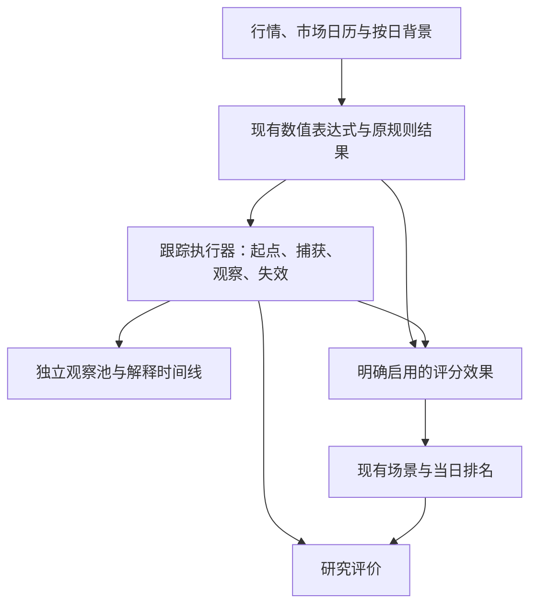

# 策略系统表达能力的收敛方案

后续维护者请继续维护本文：新增能力要对应已有研究中的具体表达困难，区分已实现、设计草案和待验证的策略；不要将候选研究参数变成系统默认交易参数。

2026-10-16。本文结合研究汇总、市场行为01—25号演化及长历史复核、筹码与确认研究、环境/行业/周期研究、脉冲量能v3和现有规则观察v4，并对照Rust和前端实现整理。数值只用于说明既有证据，不构成新的回测。

**实现状态：**已实现可选 `track`、原规则稳定 ID、`source/start`、冻结值、市场日期限、有序步骤、永久失效、当日资格和信号，以及步骤分、首次确认分、表达式控制的计分结束条件。统一评分 runner 已接入，计算排名时同时产生分数和事件检查点；使用说明与当前算法以[跟踪策略说明](TRACKING_STRATEGIES.md)为准。下文 `restore_source` 仍为未实现的早期提案，不能当作实际配置；研究评价、完整历史事件证据和盘中推进仍未实现。当前没有修改已有正式策略的分值配置或重跑收益研究。

## 1. 建议的改动

**保留数值表达式和现有规则；新增一种可选的“跟踪”对象，把发现、记忆、后续观察和当日信号分开。** 普通单日策略仍然只写原来的表达式。

跟踪可以从已有规则的实际结果开始，也可以从一个表达式开始。它负责固定这次发现的身份、捕获锚点、记住已经完成的观察、按市场日检查到期和失效。输出先进入独立观察池；恢复分值是另外明确启用的效果。

不要把研究草案里的`event_id`、版本指纹、时钟类型、可用性状态、执行优先级、检查点键等逐项搬进用户配置。这些大部分是系统必须保证的语义，不是每条策略都应回答的问题。

第一轮只做有界、每股每条跟踪一个事件的模型。结构递归、行情周期转换、市场横截面计算继续由专门组件提供数值和事件，不要求用户用通用状态机重写。

## 2. 完整研究历史反复提出了什么需求

| 研究线索与原始资料 | 实际表达需求 | 对系统的影响 |
|---|---|---|
| [市场行为01](market_behavior_handoff/docs/01_wide_market_3day_statistical.md)、[02](market_behavior_handoff/docs/02_wide_market_3day_strategy.md)至[03](market_behavior_handoff/docs/03_wide_market_3day_strategy_v2.md)、[04](market_behavior_handoff/docs/04_mainboard_8day_report.md)、[05](market_behavior_handoff/docs/05_mainboard_8day_strategy_v2_report.md) | 从单日证据发展为旧点火/换手之后，数周至数月内继续观察价格与承接 | 历史事件应能捕获价格和量，后续条件不必与起点同日成立 |
| [06并入](market_behavior_handoff/docs/06_integration_report.md)、[07规则交互](market_behavior_handoff/docs/07_interaction_report.md)、[08重拟合](market_behavior_handoff/docs/08_refit_report.md)、[09变更](market_behavior_handoff/docs/09_change_report.md)、[10跨板候选](market_behavior_handoff/docs/10_cross_board_strategy_report.md)、[11宽幅并入](market_behavior_handoff/docs/11_wide_integration_report.md)、[12互移](market_behavior_handoff/docs/12_board_rule_transfer_check.md) | 同一个概念在板块、时期和已有评分中作用不同 | 保留板块条件和独立风险贡献；表达简化不能自动合并权重或宣布有效 |
| [13触发方式](market_behavior_handoff/docs/13_scope_way_mainboard_report.md)、[14新关系](market_behavior_handoff/docs/14_mainboard_new_patterns_v3.md)、[15并入检查](market_behavior_handoff/docs/15_mainboard_v3_production_integration_check.md) | 过去命中过，与今天仍合适，是两个条件；持续承接也不等于重复奖励 | 跟踪寿命、今日资格、已经完成的观察分别表达，避免扩大`ANY`窗口代替 |
| [16深埋正例](market_behavior_handoff/docs/16_buried_positive_promotion.md)、[17删减](market_behavior_handoff/docs/17_rule_pruning.md)、[18动态指标](market_behavior_handoff/docs/18_indicator_dynamics.md)、[19决策](market_behavior_handoff/docs/19_decision_and_indicator_strategy_plan.md) | 新信息、重复信息、榜单提升不是一回事 | 引用已有规则实际结果，避免复制条件；保留增量和实际席位比较 |
| [20场景缩放](market_behavior_handoff/docs/20_indicator_scene_scaled_merge.md)、[21场景融合](market_behavior_handoff/docs/21_unified_scene_and_candidate_correlation.md) | 想展示一个观察状态，却必须用分数及阈值缩放来减小主榜扰动 | 观察输出应有明确的零主榜影响通道，无需用很小的分数模拟 |
| [22新标签](market_behavior_handoff/docs/22_split_board_subinterval_sample_report.md)、[23完整重跑](market_behavior_handoff/docs/23_split_board_full_research.md)、[24排名对照](market_behavior_handoff/docs/24_rank_layer_strategy_selection.md)、[25环境](market_behavior_handoff/docs/25_market_regime_and_similarity.md) | 后验启动、前瞻最强、持有收益与模型分数不同；环境有阶段依赖 | 研究目标属于评价器；横截面模型属于独立计算能力，不能伪装成单股时间序列表达式 |
| [筹码定义](research/chip_duration/metrics.md)、[字段简化](research/chip_duration/simplification_report.md)、[版本2全库](research/chip_duration/full_db_v2/report.md) | 少量用户字段可以建立在复杂内部状态上；字段大小不自动规定买卖方向 | 隐藏计算状态，保留数据版本和有效性；不继续增加统一“安全分” |
| [筹码释放后换手](research/chip_duration/rebound_full_history/turnover_report.md) | 先定位释放，再累计其后的成交，不能拿包含释放前成交的固定窗口替代 | 提供事件年龄和冻结值，复用动态求和等现有算子 |
| [起涨确认交接](STRATEGY_CONFIRMATION_HANDOFF.md)、[80方案复核](research/chip_duration/rank_confirmation/long_history/restart_report.md)、[掉榜重启](research/chip_duration/rank_confirmation/long_history/dropout_restart_report.md) | 原发现消失、现在仍值得跟踪、值得占百强席位，是三个问题 | 观察池独立于今日主榜；恢复分数必须单独评价，不能统一保分 |
| [长历史总复核](research/long_history_all_prior/report.md)、[覆盖表](research/long_history_all_prior/coverage.md)、[换手筛选](research/long_history_restart/report.md) | 同日同市值分位、前500内换人，不能只由一只股票自己的历史计算 | 横截面特征和候选排序有独立计算阶段，跟踪不是所有需求的解法 |
| [短周期](research/market_size_liquidity/short_cycle/report.md)、[小盘阶段](research/market_size_liquidity/small_cycles/report.md)、[财富风格](research/market_size_liquidity/wealth_style/report.md)、[切换](research/market_size_liquidity/wealth_style/switch_timing/report.md) | 两窗口共同确认后记住阶段，分化时不立即忘记；相对强不等于自身上涨 | 连续阶段与原始指标并存；市场方向和大小盘相对风格保持独立字段 |
| [连续市场状态](research/market_state_linear/report.md)、[固定周期](research/board_cycles/report.md)、[递归结构](research/board_structure_nested/report.md)、[总量能](research/market_total_activity/report.md) | 发生日和确认日不同；防线破坏、转换尝试、旧结构恢复有专门逻辑 | 共用时间和解释记录契约，但结构算法继续专门实现；不将方向/量能硬编码成统一入场门槛 |
| [打板风格](research/board_style/report.md)、[环境](research/board_environment/report.md)、[板块共振](research/board_sector/report.md)、[行业领涨](research/industry_leadership/report.md) | 前日背景、当日收盘共振、之后成功率的可知时间不同；不同目标可能背离 | 背景字段标记可知时间；策略不能读取尚未完成的结局，描述分数不自动成为仓位开关 |
| [KDJ方向](research/kdj_directions/report.md)、[亏损诊断](research/kdj_directions/loss_report.md)、[休市前承接](research/preholiday_washout/weekend_report.md) | 静态低位与首次进入/离开不同；自然周期近似与真实周期不同；休市不是缺行情 | 静态条件仍用普通表达式；首次进入可用已有交叉/前值或跟踪，周期与日历由数据层负责 |
| [脉冲v3](research/volume_pulse_samples/strategy_v3/report.md)、[原规则观察v4](research/volume_pulse_samples/existing_rule_wash_v4/report.md) | 固定首次锚点、按顺序完成缩量再反弹、捕获组合真实分值、区分延续与确认 | 是最直接的跟踪功能验收样本；两轮结果均不支持把所有观察统一恢复成正式分数 |

早期文件应结合后续覆盖表阅读：旧标签富集、旧筹码版本和旧配置结果不能当作现行策略证据。上述归纳是表达需求的提取，并没有将旧研究结论全部沿用。

## 3. 当前实现真正缺在哪里

### 数值表达式已足够承担大多数计算

`lianghua-core/src/expr`已经有MA、HHV、LLV、CROSS、BARSLAST、GET，以及带上限的SUMD、COUNTD、LLVD、REFD等。先发生事件、再统计事件之后的换手，不必再造一套求和语言。

`GET`查的是此前窗口内最近命中，不含当天；`GETD`只是让查找窗口逐日变化。二者都不保存“首次事件存活期间禁止换锚”的身份。给GET再加一个窗口参数不能解决这个缺口。

### 组合评分不表达时序过程

`lianghua-scoring/src/scoring/mod.rs`先求各条件逐日命中，再聚合。组合`ANY`选窗口内命中条件数最多的一天，同数取较近一天；不是A日出现条件1、B日出现条件2就走完两个阶段。

还有一个不直观的边界：组合`CONSEC`按每个子条件分别判断窗口内是否存在连续段，子条件的连续段未必同日。它也不能充当“完整组合连续成立”或有顺序的行为链。保留旧语义，避免兼容性改动。

原规则/组合子表达式的局部变量在求值后恢复隔离，不能依靠某条表达式留下的`PULSE`或`ANCHOR`被另一条表达式偶然读到。后续需要复用时必须显式声明。

### 场景档位不是事件阶段

`build_scene_score_series`当天汇总stage_score、risk_score和各类规则命中，再按阈值决定场景档位。它没有“昨天已完成观察”的持久记忆，也不保证先trigger再confirm。

继续保留这个评分视图。跟踪状态另外命名，例如“跟踪中／观察完成／今日出现信号／已失效”，不要把两者都叫同一种confirm。

### 状态不应只藏在Runtime里

当前`Runtime`主要持有数值和布尔序列；评分按表达式预热读取一段历史后计算。跟踪需要显式市场日推进和可恢复状态，不能只在Runtime里增加几个可变变量，再让选股、回测、监控各写一套循环。

## 4. 配置只表达策略选择

以下 4.1—4.3 的跟踪语法已支持；当前另外支持 `points`、步骤 `points` 和 `score_until`，见跟踪策略说明。4.4 的恢复原分效果仍是拟议语法。参数用于说明已有研究如何落在统一模型上，不是新默认交易参数。

### 4.1 最简单的需求：发现后继续看20日

```toml
[[track]]
id = "pullback_follow"
name = "高效回调后续观察"
source = "rule_high_eff_pullback"
ttl = 20
```

`source`引用原规则的稳定ID，由管理界面首次保存跟踪时为缺少 ID 的规则生成；显示名称继续可改，ID不随单条改名/排序变化。UI在普通策略编辑框里开启后续跟踪，自动关联当前规则，不要求另建跟踪或手填ID。

语义：原规则实际贡献大于0时，在没有活跃事件的情况下开启跟踪；保存原分、来源配置和日期。子条件命中证据尚未保存。创建日age=0，第1—20个市场交易日为后续观察；第21日到期。期间新命中默认不重置原事件。

没有写评分效果，默认只进入观察池。高效回调在第一根上涨后即使失去原始6/7分，这次发现仍能被看到。

起点使用原规则**未受跟踪效果影响**的实际贡献，包含其原scope_way和组合权重，不能拿某个子条件代替。第一轮source只接受可用于这种正分发现的规则；负分风险事件可先用自定义start表达，恢复分数也不适用于负分规则。

### 4.2 需要缩量观察后反弹

```toml
[[track]]
id = "ignition_rebound"
name = "旧倍量守价后观察反弹"
source = "rule_old_volume_ignition_hold"
ttl = 20
capture = { A_CLOSE = "C", A_LOW = "L", A_VOL = "MA(V,20)" }
invalidate = "C < A_LOW * 0.97"
eligible = "AGE >= 3 AND C <= A_CLOSE * IF(ZHANG < 0.15,1.08,1.12)"
steps = [
  { name = "缩量观察完成", when = "MA(V,3) <= A_VOL * 0.8 AND COUNT(V <= A_VOL,3) >= 2" }
]
signal = "C > HHV(REF(C,1),3)"
```

用户只增加三类判断：怎样失效、今天是否仍在观察范围、先观察到什么再看今天什么信号。`capture`里的值创建时取一次，之后不随新触发更换。

- `invalidate`一旦为真，该事件永久失去输出资格；之后涨回不能恢复它。研究对照所需的原事件身份仍保留到原到期日，不能立刻择新锚冒充同一个事件。
- `eligible`只限制今天，不是永久失效。今天超过价格上界不输出，之后回到界内仍可继续；永久价格下界必须写进invalidate。
- `steps`按顺序记忆，每日最多新完成一步，每步都要求当天eligible。已经完成的缩量观察不会因反弹当天放量而被忘掉。
- 有steps时，signal只能使用**前一市场日已经全部完成**的观察资格；不能今天同时完成缩量和反弹。没有steps时，直接检查eligible和signal。
- 每日signal可以重复为真；另外自动提供“本事件首次发出信号”的一次性记录。二者都保留，不能把每日排名资格混同为一次买入指令。

这对应v4的首次事件和观察逻辑。它的锚仍是原“守价规则得分日”，不是几十天前的最初点火；要改成最初点火，必须重新定义起点并另行评价。

### 4.3 表达独立形态，不先造一条有分规则

`source`与`start`二选一。脉冲形态可以写`start = "<按已有表达式计算的脉冲发现条件>"`，捕获`HHV(C,33)`、`LLV(C,33)`和`MA(V,33)`，再等待缩量与突破。零分观察不必先加入正式scene。

开始表达式可以沿用多行局部赋值，不增加函数定义、循环或新的脚本语言。不同字段的表达式仍有各自局部作用域，不自动导出start里的临时变量。确实重复的中间值可以在后续的小范围重构中显式提取，不能靠求值顺序共享。

形态提取器输出的历史峰日、证据区间与今天才确认的时间属于运行结果。start只在可知日生效，不把信号回填到峰日。

首轮通用跟踪先复现v4的固定寿命身份政策，不声称已经逐项复现v3。v3还有突破即结束、突破后20日冷却、终止后再寻找种子等差异；如接入该原型，再增加有限的“结束后冷却”高级项，并按其协议核对。不能用默认生命周期顶替原型后继续引用原收益。

### 4.4 如果以后确实决定恢复原分

增加一项`score = "restore_source"`；缺省为观察。它应优先在研究预览中使用，写进正式配置属于明确的策略变更。

```text
恢复值 = max(事件捕获的原规则实际贡献 − 今天原规则未调整贡献, 0)
```

只在当天跟踪输出有效时恢复，不把原规则仍有的分重复加上。保留原始贡献和恢复贡献两列；正式启用时，将二者合计作为原规则的最终贡献，再按原stage统一汇总总分和场景。跟踪完成观察不自动把原stage升级成confirm，其他风险规则照常计算。

第一轮每条source最多允许一个恢复效果，防止两个跟踪重复补同一份失分。普通固定加分、衰减、场景系数和席位保护先不在这里另造配置。现有研究尚未支持通用保分，也没有证明20日是最优期限。

## 5. 系统统一规定，用户不用逐条填写

| 项目 | 统一语义 |
|---|---|
| 事件数量 | 每股每条跟踪一个原事件；没有无限事件列表 |
| 重复起点 | 活跃期默认忽略；原事件到期后才允许新建。以后需要最近事件覆盖时作为高级选项明确开启，不能悄悄重置 |
| 事件身份 | 系统生成，关联跟踪版本、股票、起点可知日与源版本；用户不写event_id公式 |
| 时间 | 生命周期按市场交易日；MA/REF等旧算子仍按个股报价序列，不偷偷改变现有表达式语义 |
| 缺失 | 市场开市但该股缺报价或必要证据缺失时，跟踪标unknown并停止有效输出；第一轮不自动恢复旧资格。全市场休市不推进年龄 |
| 历史不足 | 创建所需字段/捕获值不足则不创建，并展示证据不足；不要依赖NULL比较为false后取反的偶然结果 |
| 当日顺序 | 检查到期/缺失/失效 → 基于昨日阶段判断今日signal → 完成至多一个新观察 → 创建新事件；新事件age=0当天不做后续确认 |
| 资格与占位 | 破位/unknown可使观察失效，但首次事件的身份槽保留到原ttl；carry/wash等对照因此仍指向同一批起点 |
| 数据缺失尾部 | 即使没有后续个股报价，也按市场日推进unknown和到期，不能让记录休眠到下次报价才处理 |
| 输出 | 当前状态、每日signal、首次signal、各观察完成日、失效日与原因都提供；前端按用途选择展示 |
| 评分与依赖 | 先算原始规则结果，再算跟踪，再应用明确效果，再算场景和排名；同日排名不反向成为同日评分输入 |
| 研究与交易 | 观察不改主榜；研究结果标签不进入策略输入；成交时点和持仓冲突由交易/评价组件处理 |

永久失效与保持原身份到期是本方案为了先复现v4所选的首轮政策。它并不是所有形态的自然规律，界面应能说明“原事件已失效，等待原观察期结束”。以后要改变重入政策，需要用版本明确区分。

## 6. 继续保持简单的办法

### 只在需要记忆时创建跟踪

`J < 13`、今天缩量、今日行业强度等仍是普通表达式或字段。首次跨入状态很多时候用CROSS或与REF比较即可，不必为每个交叉创建持久对象。

更复杂的形态检测也先用当前数值算子。固定33日未覆盖人工形态，并不意味着先给引擎增加任意搜索、回溯重标和自动选参语言。

### 用引用消除起始规则复制

source直接消费同一次计算产出的规则结果和条件命中掩码。不要为了跟踪组合命中，把高效回调或旧倍量整段表达式再复制一遍。

当前旧倍量四个子条件重复点火、AGE、ANCHOR和NOT_HOT计算。后续迁移这类规则时，可以增加一个可选的规则级`prepare`多行表达式，先计算共同数值，再让各condition读取；prepare变量只读，子条件局部变量仍隔离。确需作为来源证据的值显式导出，不能自动把全部临时变量当作公共接口。

这项复用属于迁移时的小改造，第一轮source引用本身已能消除“确认规则复制原规则”的主要问题，不必同时建设全局特征注册表、宏系统和任意依赖图。

### 背景作为字段，避免环境开关膨胀

市场方向、大小盘相对强弱、活跃度、行业共振、结构方向和防线通过数据适配器按日提供。已有指数字段注入模式可以延续，按实际引用加载。

字段携带计算版本、覆盖和可知时间；前日才可用于某个决策的背景，由入口统一对齐。没有证据支持的“牛市乘1.2、小盘风格再加3分”不做成系统模板。

递归结构的破位后恢复旧结构，与本方案invalidate永久失效不同。复用其已实现的StructureEngine输出，不能拿通用跟踪替换它，否则配置会膨胀且语义失真。

### 横截面保留独立边界

GRANK/LRANK是单股历史窗口排名，不是同日全市场分位。换手三等分、同日同市值前500候选属于横截面阶段，应每日对明确股票池统一算一次，再供排序或筛选使用；不能让每个32股计算批次各自划分三分位。

长历史换手筛选更适合做独立的榜单研究方案，不宜靠把TOR换算成任意扣分来假装复现席位替换。不同目标先在评价端并列：20日收益、短窗极端命中和下探，而不是再创造一个万能总分。

冻结线性模型也应引用版本化模型产物，由专门计算器处理横截面归一化。暂时没有必要给普通用户暴露几十项权重和训练参数。

## 7. 运行架构与平板约束



### 同一个执行器用于历史与日常计算

新跟踪核心应为不访问数据库、不依赖UI的Rust状态推进器。评分runner、研究重放和观察查询都调用它。市场日历、源规则结果、所需特征作为输入；数据库读写与checkpoint在外层。

普通数值子表达式仍可预先整段计算，涉及AGE和捕获值的部分按当日上下文求值。不能为了复用Runtime，对每股每事件的每一天都重新计算从上市以来的全部序列。捕获值也不能作为整段已知字段回填到创建前的日期；只能在对应事件当时的求值上下文使用。

旧评分的总分模式、明细模式应共享同一效果执行路径，防止`scoring_rules_total_cache`和`scoring_rules_details_cache`出现两个版本。没有track的旧配置沿用原路径，不要求42条规则全体迁移。

### 首次事件记忆不能只增加预热行数

当前warmup解决的是有界数值窗口。首次活跃事件在存活期忽略新起点，连续触发时，事件按最初锚点形成分批生命周期。任意截取最近ttl天，会在截取首日误开一个事件，之后的锚点和到期相位持续偏移。

例如ttl=2，历史每日都满足起点：从第0日开始按本方案会在第0、3、6日新建；如果从第4日当成空状态开始，则会在第4、7日新建。即使只关心第6日，两者也不同。因此不能简单把`warmup += ttl`当作全量/增量一致性保证。

需要每股每跟踪的已提交状态检查点；没有匹配版本的检查点时，从明确的初始数据边界或已知空状态边界重放。分段计算从检查点恢复后推进市场日，输出只裁切用户请求的区间。

历史行情、复权版本、规则配置、日历或所依赖背景修订后，从受影响位置之前的有效检查点重放；不存在则回到起点。不能只删除日表而保留旧锚点状态。新增跟踪也不能默认从今天空状态开始后声称与历史一致。

### 状态和审计保持有界

每个槽只存起点、到期、捕获值、观察步骤完成情况、已知失效和首次signal等必要状态；历史按事件迁移和必要的每日输出保存，不把全部K线路径复制进每个事件。

默认沿用现有小批次和有界写库队列。市场/行业背景按日共享，不在每只股票里复制全市场面板；检查点与对应结果水位同事务提交。前复权修订后，捕获的旧价格也必须跟随重放，不能拿旧复权坐标的锚点与新行情比较。

实时监控首轮只读取最后已确认收盘的跟踪状态。盘中报价可作为预览，但不得逐tick推进并永久提交日线事件，否则一次盘中破位会改变收盘策略。确需盘中事件时另定义数据时钟和确认口径。

平板界面在普通策略编辑框内提供“开启后续跟踪”：勾选后显示跟踪期限与折叠的“冻结值与观察条件”，与普通策略一次保存。起点自动关联当前规则，名称、规则ID和系统元数据不占据表单；独立结果栏只负责计算和查看。高级start配置继续保留文件入口。

## 8. 实施顺序与具体边界

1. **先做观察闭环。** 可选track配置、稳定规则ID、source/start二选一、固定捕获、ttl、市场日/缺失状态、检查点、独立观察池。先迁移高效回调carry作为语义样本，默认零评分效果。
2. **加入有序观察。** 增加invalidate、eligible、steps和signal，复现旧倍量观察反弹。迁移时同时完成必要的表达式数据有效性分析与当日上下文求值，不靠NULL取反或历史回填凑结果。
3. **接通研究评价与显式效果。** 研究预览支持restore_source，复用原生状态回放。只有明确采用某个候选后才启用正式效果，所有场景和总分入口一起核验。表达式单规则回测页面需明确跟踪入口，不能悄悄按普通when进行回测。
4. **按实际用途扩展。** 需要完整脉冲v3时才加入其结束/冷却语义；需要旧点火全链时才提取prepare及源锚点；需要环境或横截面策略时才接相应数据适配器。每项扩展有具体研究对应，不提前提供任意分支、多事件并行或工作流脚本。

第一轮通用跟踪不是用来替换市场结构、筹码库存演化、真实周月K线或交易持仓机。这些组件内部可能复杂，但用户只需引用少量输出，正如筹码单系数研究所区分的“少字段”与“可恢复内部状态”。

最小验收应围绕语义，而非再跑一遍所有收益研究：一组短合成轨迹覆盖新触发不换锚、缩量完成后放量反弹、破位不复活、无报价到期、逐段恢复与整段回放一致；一组现有规则样本覆盖捕获6/7分和部分失分不重复叠加。再核对空track时旧输出、观察模式零主榜/场景影响。涉及正式恢复效果时才补同日席位和场景核验。

## 9. 本次不应顺手修改的策略细节

- 高效回调两子条件ER互斥，`LAST`下两命中10分不可达，实际为6/7分。可以在编辑器提示，但不要为了让档位可达就改动条件；那是新的策略。
- 旧倍量等规则目前用最近锚点。迁移成首次冻结会改变信号集，必须保留旧规则版本作基线，不能当纯重构。
- v4的carry允许破原低点后保留发现记录；给它增加统一守价会改变已测对象，且现有结果没有证明这样更好。
- 观察池避免忘掉原机会，但不等于保留交易席位。统一补回掉榜者、多加洗盘条件、放量才确认，都没有得到全历史一致支持。

## 10. 对应代码入口

| 入口 | 需要承担的职责 |
|---|---|
| `crates/lianghua-data/src/data/mod.rs` | 兼容旧ScoreConfig，新增可选track定义、规则稳定ID和配置校验；未知字段不可默默当作生效 |
| `crates/lianghua-core/src/expr/{parser,validation,eval}.rs` | 复用AST和数值算子，校验跟踪上下文、字段有效性与有界窗口；不引入另一套解释器 |
| 新的纯Rust跟踪模块，建议置于`lianghua-core` | 市场日状态推进、捕获、阶段记忆、输出和可恢复状态；不依赖评分/数据crate以免循环依赖 |
| `crates/lianghua-scoring/src/scoring/{mod,rule_cache,runner,tools}.rs` | 原始规则结果供给、背景/日历准备、跟踪调用、明确效果和兼容预热；两种评分模式共享语义 |
| `crates/lianghua-model/src/scoring.rs`及数据持久化层 | 观察结果、迁移记录、来源与检查点版本；与评分日值原子提交 |
| `crates/lianghua-app-strategy/src/{manage,stock_pick,paper_validation}.rs`及`statistics/validation` | 配置保存完整往返、观察查询、明确的跟踪验证入口；不各写一套事件算法 |
| `ui/lianghua_web/src/pages/desktop/StrategyManagePage.tsx`及对应API类型 | 精简纵向编辑、默认观察、时间线和失效解释；表单保存不得丢弃新字段 |
| `crates/lianghua-app-market`监控入口 | 先消费已确认日线状态，盘中预览与日线提交分离 |

这是一份首次设计，没有将尚未实施的选择写入各组件AGENTS.md。以后若在实现中改变已有方案、引入难以从代码理解的容量或参数取舍，再按项目约定维护对应组件记录。
